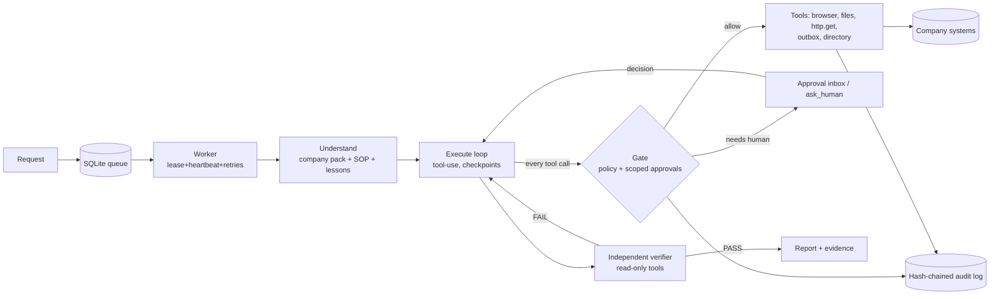

# Steward: an AI employee that does the work, asks when it must, and proves it

> CentrAlign AI Founding Engineer prototype. Problem: *AI Employee / Autonomous Company Operator.*

Give Steward a short request ("Rohan says he was charged twice, sort it out"). It understands the request using
company context, operates the company's web apps and files, is **stopped by a deterministic policy layer** when an action
needs a human, safely retries what can be retried, **independently verifies the result in the real systems**, and hands back
a report with evidence.

```
Goal -> Understand -> Plan -> Execute -> Observe -> Adapt -> Verify -> Complete
        (company      (SOP)   (tools,    (page/     (retry,   (separate   (report +
         memory)               gated)     data)      ask,      verifier,   audit +
                                                     escalate) read-only)  evidence)
```

The core (runtime, tools, permission layer, queue) contains **no task-specific code**. Three different tasks run on it by
changing only the *Company Pack* (`company_pack/`: SOPs, systems, policies, people).

| Task | Systems / tools | What it demonstrates |
|---|---|---|
| A. New-employee onboarding | Admin Console (browser forms), directory, email | multi-step forms, privileged-group approval, rejection handling |
| B. Customer refund from a ticket | Helpdesk + Billing (two apps, browser) | cross-app context, amount-based policy, approval pause/resume, mismatch questions |
| C. Weekly ops report | CSV export + Billing API + email (no browser) | file/API tools, reconciliation, scheduled/background run |

## What makes it more than "an LLM with a browser"

1. **Policy is outside the model.** The LLM proposes; `Gate.check` decides, using tool + *arguments* (refund > INR 2000 needs a
   finance manager, > INR 50,000 is denied, privileged groups need IT-security). Fail-closed.
2. **Safety at the network layer.** Every non-GET request the browser makes is intercepted, classified by `systems.yaml`, gated
   *before it is sent*, tagged with a deterministic `Idempotency-Key`, and retried only when that is provably safe.
3. **Approvals are scoped grants**: bound to (task, tool, exact args), expiring, single-use. Approving "refund 4200" cannot be
   replayed as "refund 9000". A rejection is a hard stop and its comment becomes a lesson for future runs.
4. **Independent verification.** A separate verifier pass gets only read-only tools and checks the *live systems* against the
   success criteria. FAIL sends the agent back; repeated failure escalates instead of claiming success.
5. **Durable and resumable.** SQLite queue with leases, heartbeats, exponential backoff + jitter, dead-letter, scheduled runs,
   and checkpointed conversations so a pause (approval/question) or a crash resumes where it left off.
6. **Tamper-evident audit + evidence.** Hash-chained event log; screenshots/reports/emails stored content-addressed with sha256.
7. **Measured, not claimed.** `python -m steward eval` scores runs against ground truth in the systems (see *Evaluation*).

## Quickstart
```bash
python3 -m venv .venv && source .venv/bin/activate        # fish: source .venv/bin/activate.fish
python -m pip install -r requirements.txt
python -m playwright install chromium                      # on Ubuntu 20.04 skip this and use system Chrome (below)
cp .env.example .env                                       # choose an LLM backend, see below
python -m pytest -q                                        # ~70 tests, no API key needed (scripted LLM, real browser)

# terminal 1: the mock company systems (Admin Console, Helpdesk, Billing on :8800)
python -m mock_apps.server
# terminal 2: run a task; the live timeline asks YOU when a human decision is needed
STEWARD_HEADLESS=0 python -m steward run "Rohan Mehta wrote in (ticket T-501) saying he was charged twice for October. Please sort it out."
```

More tasks (each exercises a different SOP, no code change between them):
```bash
python -m steward run "Ananya Rao (ticket T-502) says her order A-1002 arrived damaged and wants a full refund."   # > INR 2000: approval
python -m steward run "New hire joining Monday: Kavya Menon, Engineering, Software Engineer, manager is Dev Patel. Please get her ready."
python -m steward run "New hire: Arjun Verma, Finance, Analyst, manager Priya Nair. Also add him to finance-admins."  # reject the approval
python -m steward run "Please do the weekly orders reconciliation and send the summary to the Operations Lead."
python -m steward submit "..." --at "2026-10-07 09:00"     # background/scheduled; `python -m steward worker` runs the queue
python -m steward audit <task_id> ; python -m steward report <task_id> ; python -m steward verify-audit
```
Reset the mock apps between demos (or restart the server): `curl -X POST localhost:8800/__reset`.
Chaos for reliability demos: `curl -X POST localhost:8800/__chaos -H 'content-type: application/json' -d '{"fail_after_apply": 1}'`
(also `fail_next_mutations`, `slow_ms`, `ui_variant: "B"`).

**Ubuntu 20.04 / no bundled Chromium:** set `STEWARD_BROWSER_CHANNEL=chrome` in `.env` to drive the installed Google Chrome.
**Watch the browser (demo video):** `STEWARD_HEADLESS=0`.

## Models and APIs used
| Purpose | What |
|---|---|
| Agent + verifier LLM (default, production path) | **Anthropic Messages API**, model `claude-sonnet-5-5`, tool use, forced-tool structured output for the task spec and the verdict, prompt caching |
| Alternative backends (config switch `STEWARD_LLM`) | `claude_code` (the unmodified `claude` CLI on a personal Claude plan, schema-constrained JSON), `gemini` / `groq` / `openrouter` / `ollama` (OpenAI-compatible) |
| Browser automation | Playwright (Chromium or system Chrome) |
| Mock company systems | FastAPI + uvicorn (Northwind Admin Console, Helpdesk, Billing) |
| State | SQLite (WAL) |

**Disclosure:** the live runs, evaluation results and demo video in this repo were produced with the `claude_code` backend on my
own Claude plan (personal local development; I had no API credits during the build). That mode is for personal use only: a shared
or deployed Steward must use `STEWARD_LLM=anthropic` with an API key (`ANTHROPIC_API_KEY`). The backend choice is behind one
interface (`steward/llm.py`) and the test-suite never needs a model.

| `STEWARD_LLM` | Auth | Use for |
|---|---|---|
| `anthropic` (default) | `ANTHROPIC_API_KEY` | production, evaluation, any deployment |
| `claude_code` | your own plan via `claude -p` (sign in once with `/login`) | personal local dev/demo only |
| `gemini`, `groq`, `openrouter`, `ollama` | provider key | cheap iteration, offline |

With `claude_code` the CLI's own tools are disabled and `ANTHROPIC_API_KEY` is stripped from the child environment: Claude only
returns the next action as JSON and Steward executes it behind the policy gate. Plan usage limits surface as a transient error;
the task backs off and resumes from its checkpoint.

## Architecture (short; full version in `docs/ARCHITECTURE.md`)

Key modules: `runtime.py` (loop), `gate.py` + `policy.py` (permissions), `tools/browser.py` (network-level mutation gate),
`queue.py` + `worker.py` (durability), `memory.py` (company pack, lessons), `audit.py` (audit + evidence), `llm.py` (backends),
`evals.py` (ground-truth evaluation).

## Evaluation (ground truth, not self-report)
`python -m steward eval [--only ids] [--repeat N]` resets the mock systems, injects chaos, runs the task with simulated approvers,
and checks the **real state of the systems** (refund count/amount, group membership, mails, report contents), the audit hash chain
and the evidence hashes. It also measures **verifier false-PASS** (verifier said PASS but ground truth was wrong).

Results from my runs (backend `claude_code`; `eval_results/` has the reports):

| scenario | injected condition | final status | ground truth | verifier | steps |
|---|---|---|---|---|---|
| refund_small | none (INR 750, under the limit) | completed | OK | PASS | 12 |
| refund_5xx_retry | Billing returns 503 *before* applying, twice | completed | OK | PASS | 11 |
| refund_applied_but_503 | refund **applied** but the response is 503 (a blind retry would double-refund) | completed | OK, exactly 1 refund | PASS | 11 |
| refund_large_approved | INR 4200 > limit: pause, finance-manager approves | completed | OK | PASS | 9 |
| refund_large_rejected | finance-manager rejects the INR 4200 refund | needs_human | OK, no refund, agent reached the gate | n/a | 5 |
| refund_ui_variant_b | buttons/labels renamed | completed | OK | PASS | 13 |
| onboard_eng | none | completed | OK | PASS | 9 |
| onboard_ui_variant_b | buttons/labels renamed | completed | OK | PASS | 8 |
| onboard_finance_priv_approved | IT-security approves `finance-admins` | completed | OK | PASS (see below) | 9 |
| onboard_finance_priv_rejected | IT-security rejects `finance-admins` | needs_human | OK, rest of onboarding done, group not granted | n/a | 10 |
| weekly_report | read-only reconciliation, 3 seeded discrepancies | completed | OK | PASS | 4 |

**Honest run history (14 attempts, 11 scenarios):** 11 passed, 1 genuine failure, 2 not counted.
- *Genuine failure (fixed):* `onboard_finance_priv_approved` ended `needs_human` because the verifier said INCONCLUSIVE: the work was right
  (ground truth OK) but the verifier had no way to see that a human had approved the privileged group. Fix: the verifier now receives the
  permission layer's own approval records. The scenario passed afterwards (only one re-run, so treat as a fix, not a statistic).
- *Not counted (infrastructure):* two runs hit my Claude plan's session limit. The classifier did not recognise that message at the time and
  dead-lettered them in seconds. Fixed: quota errors now defer the task until the reset without burning attempts, and `eval` refuses to score
  a run that was interrupted by a quota.
- Across all scored runs: 0 verifier false-PASS, audit hash chain and evidence hashes intact, the gate performed 3 safe idempotent write retries.

**Read this as evidence that the mechanisms work, not as a pass rate.** It is one successful run per scenario on one model backend; the
agent is non-deterministic. `python -m steward eval --repeat 3` gives a better picture.

## Design decisions (and the trade-offs)
1. **Deterministic policy engine, not a prompt.** A prompt can be talked around; a gate cannot. Cost: policies are a small sandboxed
   expression subset, not a full language (OPA/Cedar would be the production choice).
2. **Intercept at the network layer, not by trusting clicks.** The agent can click anything; only classified, gated requests leave
   the browser. Cost: classification needs `systems.yaml` entries per system (that is the onboarding work for a new app).
3. **Idempotency over hope.** Writes carry deterministic keys so "applied but the response failed" cannot double-apply. Needs the
   target system to honour idempotency keys (the mock does; many real APIs do).
4. **Verifier is a separate pass with read-only tools** and the gate's own record of writes, so success is judged against reality.
   Cost: extra LLM calls per task. It also takes into account clarifications the requester gave mid-task.
5. **Checkpoint, don't block.** Approvals and questions end the run segment; any worker resumes. Cost: browser page state is lost
   across a pause, so the agent re-fills the form (the gate still binds the approval to the exact same arguments).
6. **Company knowledge is data.** SOPs are markdown, policy is YAML. A new workflow is a new pack entry, not new code. Cost: the
   quality of SOPs bounds the quality of the agent (e.g. one SOP line made it ask when a request contradicts the ticket).
7. **LLM behind an interface.** Anthropic API by default; other backends for dev. Cost: weaker backends are less reliable at tool use.

## Known limitations
- **Mock systems only.** No real SaaS auth (SSO/MFA/captcha), no pagination or file uploads in the demo apps.
- **Agent behaviour is non-deterministic.** Across runs the same request produced slightly different paths (e.g. whether it asked
  about a reason mismatch before the SOP line was added). The gate and verifier bound the damage; they don't make the model deterministic.
- **Inference where data is missing.** For "charged twice" it infers one charge = half the order total and says so in the report.
- **Cost / latency.** On the `claude_code` backend a run is 8-14 steps, ~100-250k tokens and 1-3 minutes, because history is
  re-sent every step. API prompt-caching should reduce the cost but I have not benchmarked it.
- **Audit log:** tail truncation is undetectable without an external anchor (e.g. periodically publishing the head hash).
- **Browser form state is lost after an approval pause** (re-filled on resume).
- **Retrieval is simple BM25** over SOPs/lessons; no embeddings, no cross-company isolation (single tenant).
- **Single-node SQLite**; lease/claim/recovery logic is unit-tested, a worker fleet is not.
- **No dashboard yet:** approvals and timelines are CLI-only.
- **Eval sample is small** (one passing run per scenario, one backend); a larger repeated run is the obvious next step.

## What I would do next
1. Approvals inbox + timeline + evidence viewer (web), and Slack/email approval channels.
2. Real connectors (OAuth/API tools) next to the browser, with the same gate; browser as the fallback for apps without APIs.
3. Persist browser state (storage state + page URL) across approval pauses.
4. Policy language upgrade (OPA/Cedar), per-role budgets, rate limits and kill switch.
5. External audit anchoring; multi-tenant company packs and isolation.
6. Larger eval: 30+ scenarios x N runs, cost/latency tracking, regression gate in CI, cheaper model for routine verifier steps.
7. Learn SOPs from successful runs (propose a new SOP draft for human review).

## Assumptions
- The sample company "Northwind Retail" and its people, policies and apps are fictional; amounts are INR.
- Policy thresholds (INR 2,000 auto-approve, 50,000 hard cap) and approver roles are illustrative.
- The requester identity is trusted (`ops@northwind.example`); the agent acts as the `ops-agent` role with an allow-list of tools.
- Mock apps honour `Idempotency-Key`; billing is the system of record for reconciliation.
- Email is a local outbox file (no SMTP) so demos have no side effects.

## Repo map
```
steward/            core: runtime, gate, policy, memory, queue, worker, audit, llm, evals, cli, tools/
company_pack/       the ONLY place company-specific knowledge lives: policies.yaml, systems.yaml, directory.yaml, sops/*.md
mock_apps/          Northwind Admin Console / Helpdesk / Billing with chaos toggles (separate from the core)
company_files/      sample shared folder (orders export)
tests/              ~70 tests: policy, gate, memory, queue, runtime (scripted LLM), real-browser network gate, e2e, eval oracles, LLM backends
docs/               ARCHITECTURE.md, DEMO_SCRIPT.md
eval_results/       reports from `python -m steward eval`
```
